# Visual Preview Gallery / 多语言与主题渲染全览 (`akatechreport`)

All screenshots below are compiled directly from the same single-source files ([`main.tex`](main.tex), [`sections/*.tex`](sections/), [`figures/*.tex`](figures/)) by switching only the `theme=` and `lang=` options of [`style/healthcard.sty`](style/healthcard.sty).

- **Default Theme (`theme=akatechreport`)**: Health-Card UI — Sky Cyan `#5BCEFA` · Blossom Pink `#F5A9B8` · Pure White `#FFFFFF` (with B&W print-verified high-contrast shades; `theme=pastel` kept as an alias).
- **Featured Theme (`theme=claude`, alias `anthropic`)**: `anthropic.com` / `claude.ai` Editorial System (`frontend-design` + `brand-guidelines`) — Warm Parchment `#F5F4ED` / `#FAF9F5` / Oatmeal `#F0EEE6` rounded cards (`arc=8–10pt`), Serif Display `#141413`, Mono metadata labels (`TECHNICAL REPORT`, `ABSTRACT`, `KEYWORDS`), Obsidian `#141413` contrast CTA/KPI #1/Artifact code blocks, Terracotta `#D97757` + Slate Blue `#6A9BCC` + Sage `#788C5D`.
- **Featured Theme (`theme=apple`, alias `cupertino`)**: `apple.com` + `apple-design` System — Top Local-Nav Hairline · Centered Keynote Hero `#1D1D1F` · Solid `#0071E3` Action Blue Primary CTA · Borderless Studio Grey `#F5F5F7` Bento Sheets (`arc=10pt`) · Stage Black `#000000` Code & Hardware Spec Tiles (`#2997FF` Sky Blue).
- **Quick Navigation**: [Pure English (`lang=en`)](#1-pure-english-themeakatechreport-langen--pdflatex-type-1) · [Pure Chinese (`lang=zh`)](#2-pure-chinese-themeakatechreport-langzh--xelatex) · [Bilingual (`lang=bilingual`)](#3-bilingual-themeakatechreport-langbilingual--xelatex) · [Claude Editorial (`theme=claude`)](#4-anthropic--claude-theme--claude-主题全览-themeclaude--anthropic) · [Apple Style (`theme=apple`)](#5-apple-theme--apple-主题全览-themeapple--cupertino) · [Theme Gallery](#6-built-in-theme-gallery--内置主题对比)

---

## 1. Pure English (`theme=akatechreport, lang=en` · `pdfLaTeX` Type 1)

Compiled via `make` (`latexmk -pdf main.tex`, zero `-shell-escape`, 30/30 embedded Type 1 fonts, arXiv-safe).

<table>
  <tr>
    <td width="50%" align="center">
       
      <b>EN · Page 1</b> — Header Card, Dual 18pt Logos, Clickable ORCID & Two-Column Introduction
    </td>
    <td width="50%" align="center">
       
      <b>EN · Page 2</b> — 10pt Mini Running-Header Logo, Bento KPI Tiles, Definition, Theorem & Algorithm Card
    </td>
  </tr>
  <tr>
    <td width="50%" align="center">
      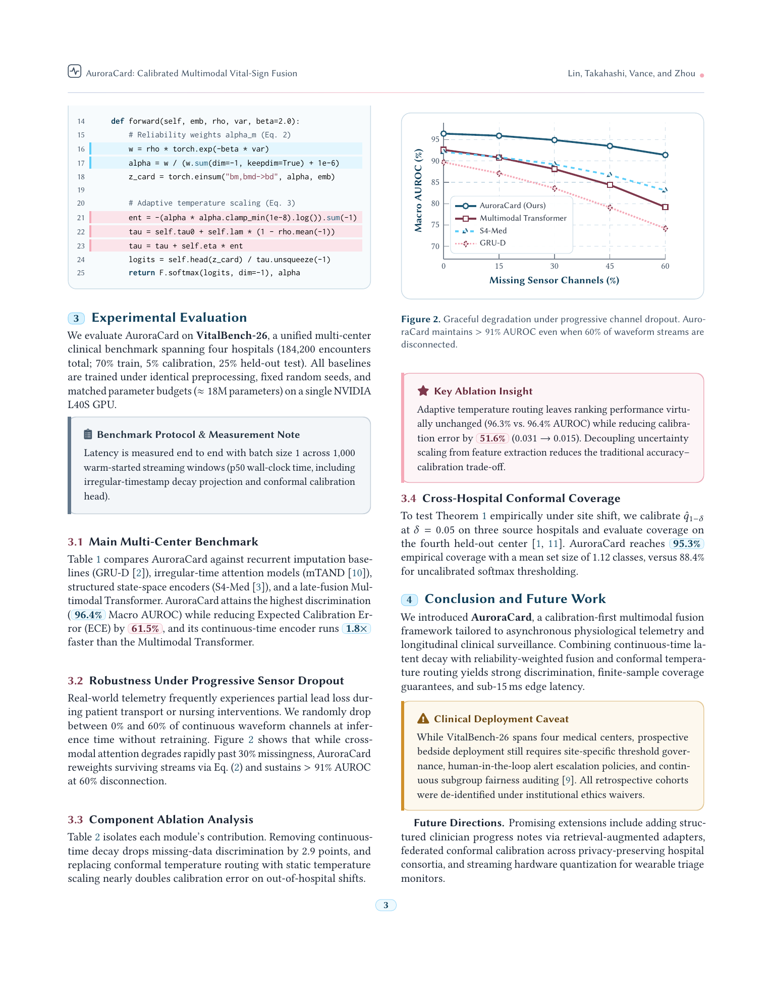 
      <b>EN · Page 3</b> — Pure-<code>listings</code> Key-Line Highlighting, Note & Caveat Cards, Native PGFPlots Figure
    </td>
    <td width="50%" align="center">
      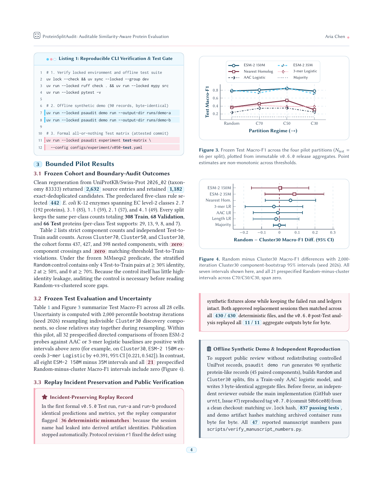 
      <b>EN · Page 4</b> — Delta-Badge Benchmark Table, Ablation Table, ORCID Directory & Hardware Spec Card
    </td>
  </tr>
</table>

---

## 2. Pure Chinese (`theme=akatechreport, lang=zh` · `XeLaTeX`)

Switch a single option (`lang=zh`) and run `make xelatex` (`FandolSong` / `FandolHei` / `FandolKai`, built into TeX Live). All UI labels (`摘要`, `关键词`, `图`, `表`, `算法`, `代码清单`, `定义`, `定理`, `参考文献`, `作者 ORCID 标识`, `硬件与评估环境`) localize automatically.

<table>
  <tr>
    <td width="50%" align="center">
      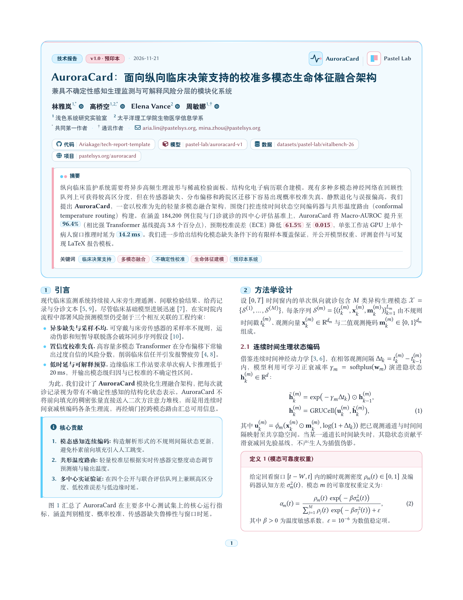 
      <b>ZH · 第 1 页</b> — 中文主副标题、中英混排摘要卡片、关键词胶囊与《核心贡献》卡
    </td>
    <td width="50%" align="center">
       
      <b>ZH · 第 2 页</b> — 全宽 Bento KPI 指标格、定义/定理卡片、算法卡片与代码行高亮
    </td>
  </tr>
  <tr>
    <td width="50%" align="center">
       
      <b>ZH · 第 3 页</b> — 跨栏实验主表（增幅徽章）、原生 PGFPlots 曲线、消融对比表与提示卡片
    </td>
    <td width="50%" align="center">
       
      <b>ZH · 第 4 页</b> — 作者 ORCID 标识自动索引、硬件环境配置卡与双栏参考文献
    </td>
  </tr>
</table>

---

## 3. Bilingual (`theme=akatechreport, lang=bilingual` · `XeLaTeX`)

Switch `lang=bilingual` (`biorder=zh-en` or `en-zh`) to render paired Chinese + English Header Card, paired abstracts & keyword pills, bilingual headings/captions, and `\hcbipair` prose blocks from the same `.tex` source.

<table>
  <tr>
    <td width="50%" align="center">
      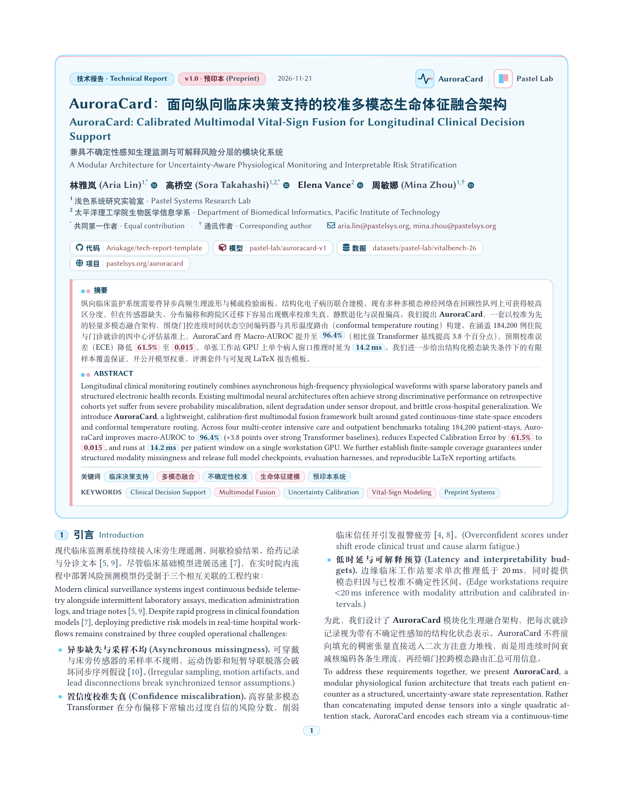 
      <b>Bilingual · Page 1</b> — 双语标题与作者隶属、双语摘要及关键词胶囊、双语对照引言
    </td>
    <td width="50%" align="center">
      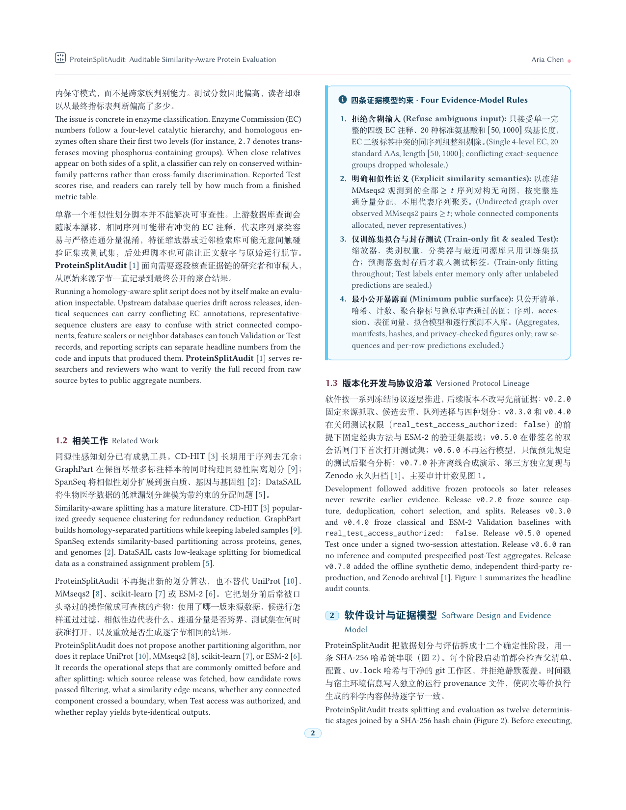 
      <b>Bilingual · Page 2</b> — 核心贡献双语卡片、双语公式推导、定义与定理对比卡片
    </td>
  </tr>
  <tr>
    <td width="50%" align="center">
      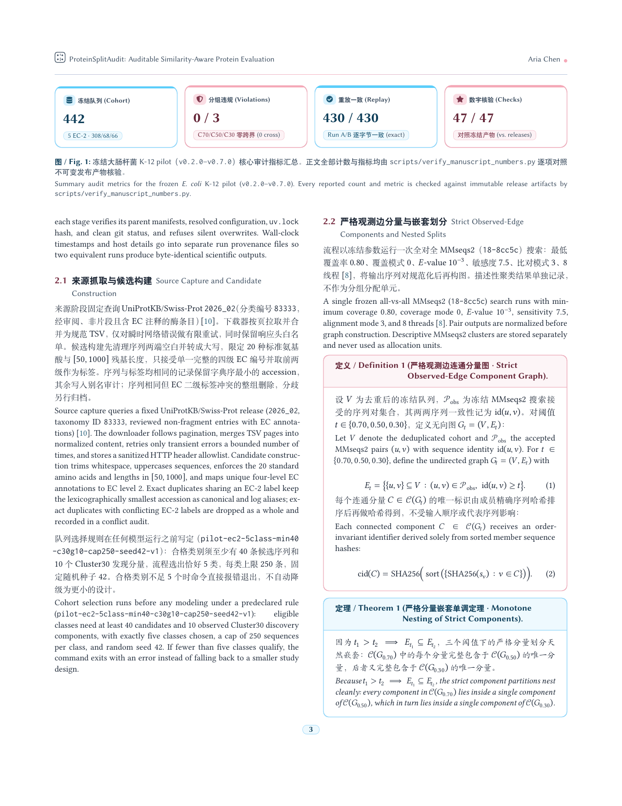 
      <b>Bilingual · Page 3</b> — 双语 Bento KPI 指标格、算法框、高亮代码卡与基准评测口径说明
    </td>
    <td width="50%" align="center">
       
      <b>Bilingual · Page 4</b> — 双语表头与图注、增幅徽章表格、消融表及消融洞察卡片
    </td>
  </tr>
  <tr>
    <td colspan="2" align="center">
      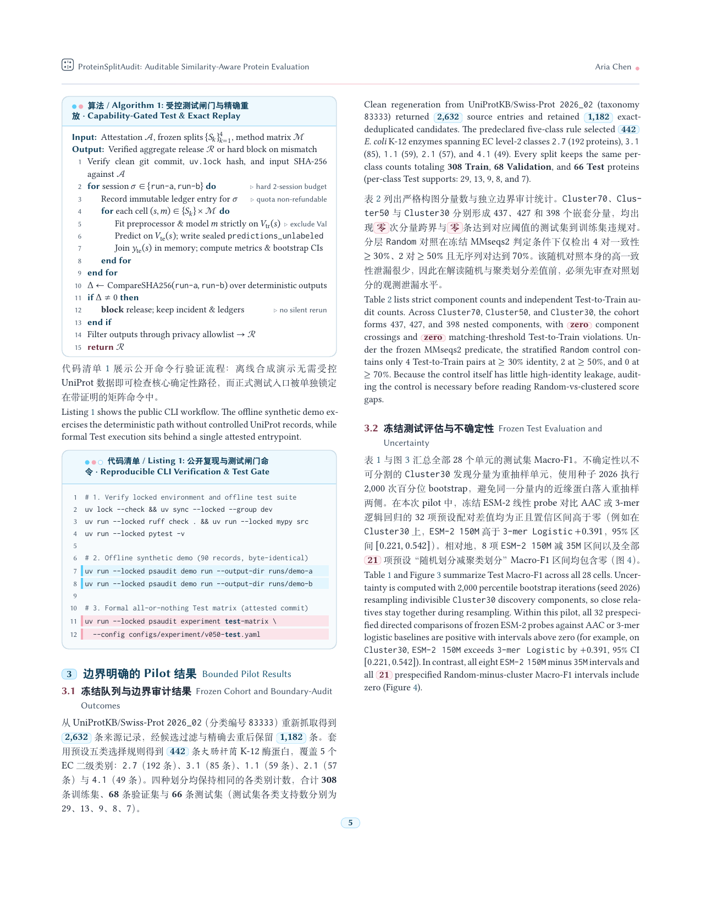 
      <b>Bilingual · Page 5</b> — 临床部署边界提示卡片、双语声明致谢、ORCID 索引与硬件评估环境卡
    </td>
  </tr>
</table>

---

## 4. Anthropic / Claude Theme / Claude 主题全览 (`theme=claude` · alias `anthropic`)

Use `\usepackage[theme=claude, lang=en]{style/healthcard}` (or `theme=anthropic`). Modeled directly after `anthropic.com` and `claude.ai` (`frontend-design` + `brand-guidelines`): Warm Parchment `#F5F4ED` hero card, `#FAF9F5` / Oatmeal `#F0EEE6` rounded containers (`arc=8–10pt`, subtle `#E2DFD5` cream borders), Serif display typography (`#141413`), Anthropic Mono uppercase labels (`TECHNICAL REPORT`, `ABSTRACT`, `KEYWORDS`), solid `#141413` Slate Ink dark contrast anchors (version pill, `Code` CTA capsule, Hero KPI #1 card, and `#141413` Artifact code block), and Terracotta `#D97757` / Slate Blue `#6A9BCC` / Sage `#788C5D` accents.

<table>
  <tr>
    <td width="50%" align="center">
      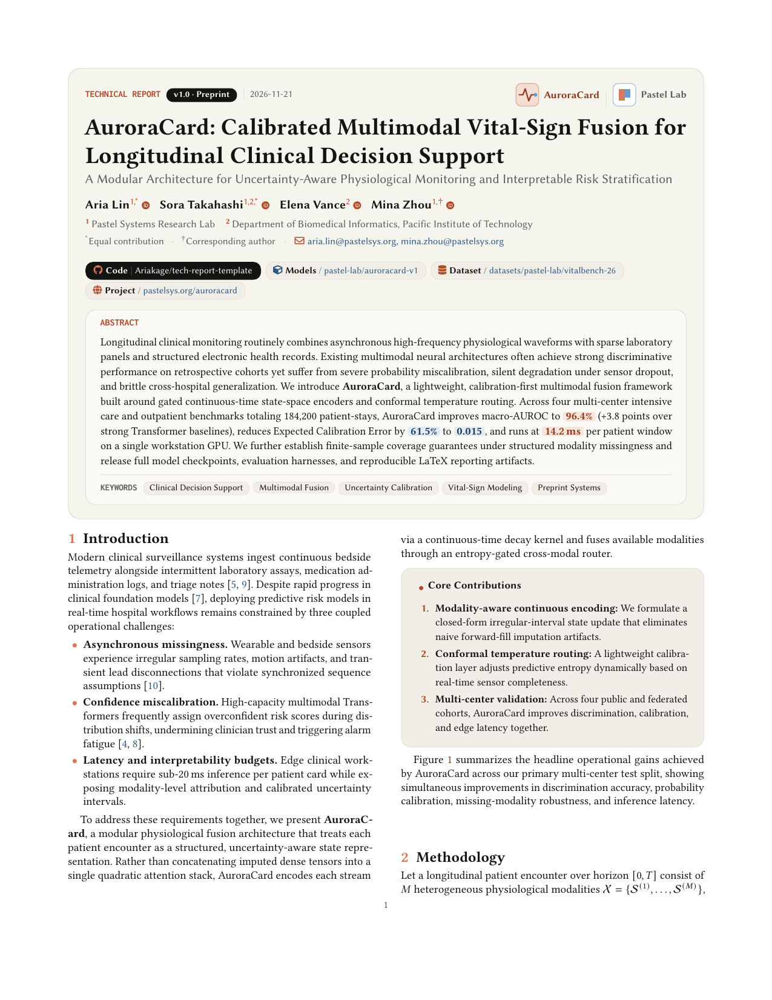 
      <b>Claude · Page 1</b> — Warm Parchment Hero, Obsidian CTA Capsule & Mono Eyebrow Abstract
    </td>
    <td width="50%" align="center">
      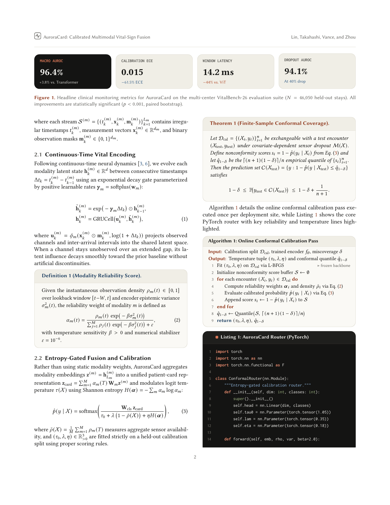 
      <b>Claude · Page 2</b> — Obsidian KPI #1 Contrast Tile, Cream Cards & `#141413` Code Block
    </td>
  </tr>
  <tr>
    <td width="50%" align="center">
       
      <b>Claude · Page 3</b> — Warm Artifact Code Continuation, Anthropic Plot & Sage/Terracotta Callouts
    </td>
    <td width="50%" align="center">
      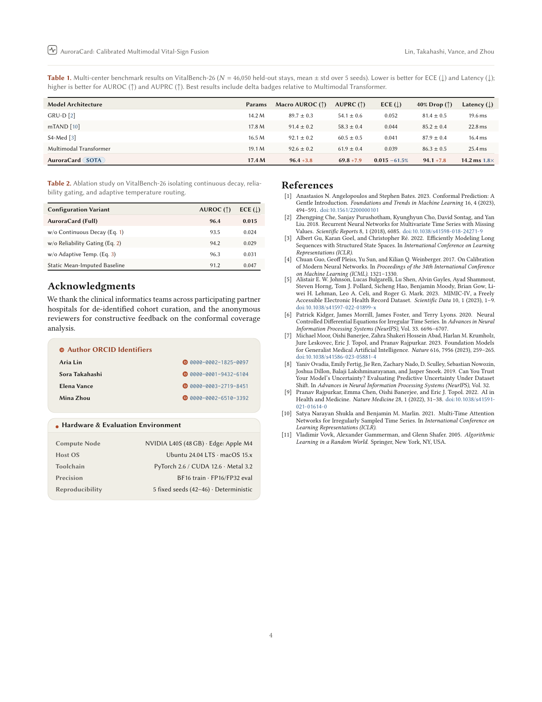 
      <b>Claude · Page 4</b> — Parchment Tables, Terracotta Deltas, Oatmeal ORCID & Env Cards
    </td>
  </tr>
</table>

---

## 5. Apple Theme / Apple 主题全览 (`theme=apple` · alias `cupertino`)

Use `\usepackage[theme=apple, lang=en]{style/healthcard}` (or `theme=cupertino`). Modeled directly after `apple.com` and `apple-design`: crisp local-nav hairline strip above a **centered keynote Hero** (`#1D1D1F` bold Sans + `#6E6E73` Pewter subhead + solid `#0071E3` Action Blue primary CTA capsule), borderless Studio Grey (`#F5F5F7`, `arc=10pt`) Bento & Abstract cards, monochrome Space Titanium (`#424245`) + Link Blue (`#0066CC`) accents, and **`#000000` Stage Black** dark product blocks for code listings (`#2997FF` Sky Blue keywords & macOS dots) and hardware specs.

<table>
  <tr>
    <td width="50%" align="center">
      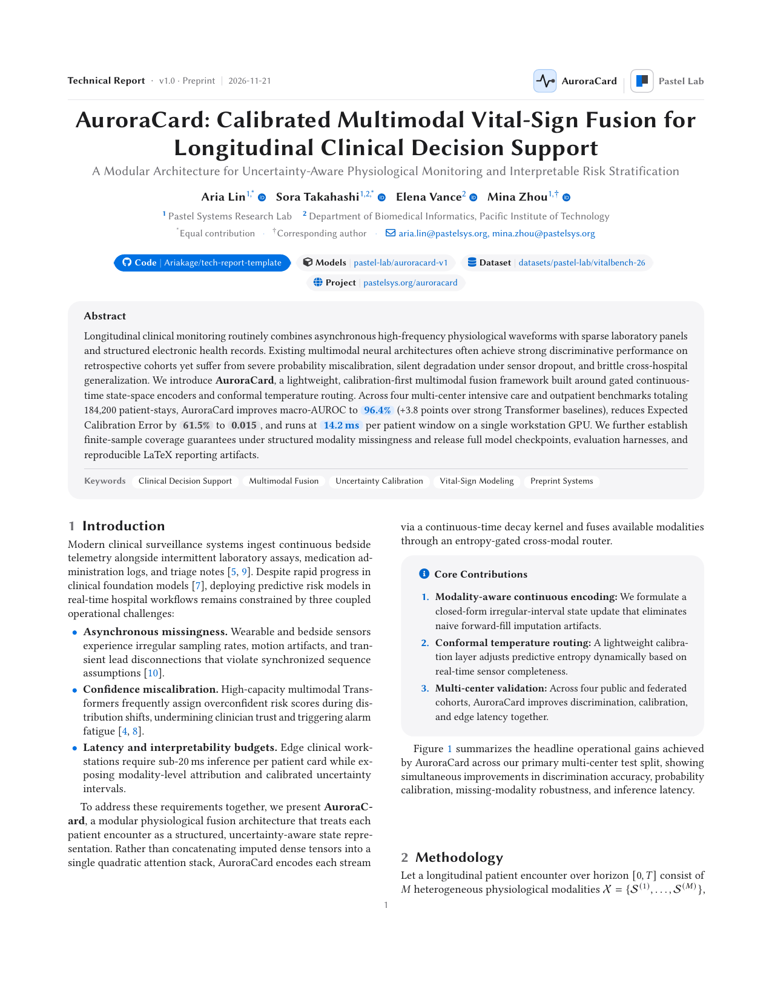 
      <b>Apple · Page 1</b> — Local-Nav Hairline, Centered Keynote Hero, Solid `#0071E3` CTA & Grey Abstract
    </td>
    <td width="50%" align="center">
       
      <b>Apple · Page 2</b> — Borderless Studio Grey Bento, Hairline Theorem & Stage Black `#000000` Code
    </td>
  </tr>
  <tr>
    <td width="50%" align="center">
       
      <b>Apple · Page 3</b> — Stage Black Listing, Studio Grey Sheets (No Side Bars) & Clean Plot
    </td>
    <td width="50%" align="center">
       
      <b>Apple · Page 4</b> — Soft Hairline Tables, Titanium Deltas, Grey ORCID & Stage Black Hardware Tile
    </td>
  </tr>
</table>

---

## 6. Built-in Theme Gallery / 内置主题对比

Switch palette across the entire template with a single `theme=` option (plus custom HEX skinning via `\hcsettheme{primary=..., accent=...}`).

<table>
  <tr>
    <td width="33.3%" align="center">
       
      <code>theme=claude</code>
    </td>
    <td width="33.3%" align="center">
       
      <code>theme=apple</code>
    </td>
    <td width="33.3%" align="center">
       
      <code>theme=ocean</code>
    </td>
  </tr>
  <tr>
    <td width="33.3%" align="center">
      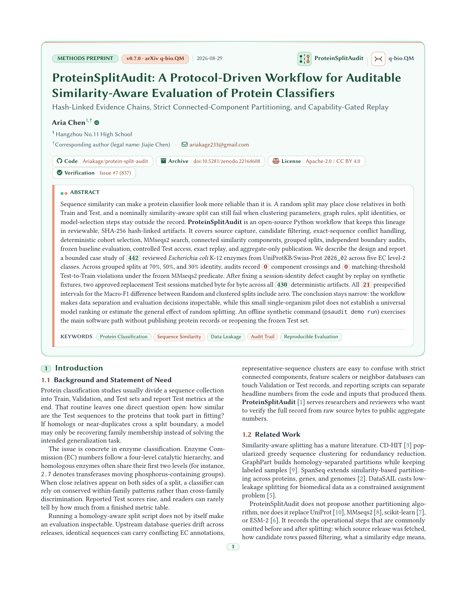 
      <code>theme=sage</code>
    </td>
    <td width="33.3%" align="center">
       
      <code>theme=lavender</code>
    </td>
    <td width="33.3%" align="center">
       
      <code>theme=mono</code>
    </td>
  </tr>
</table>
