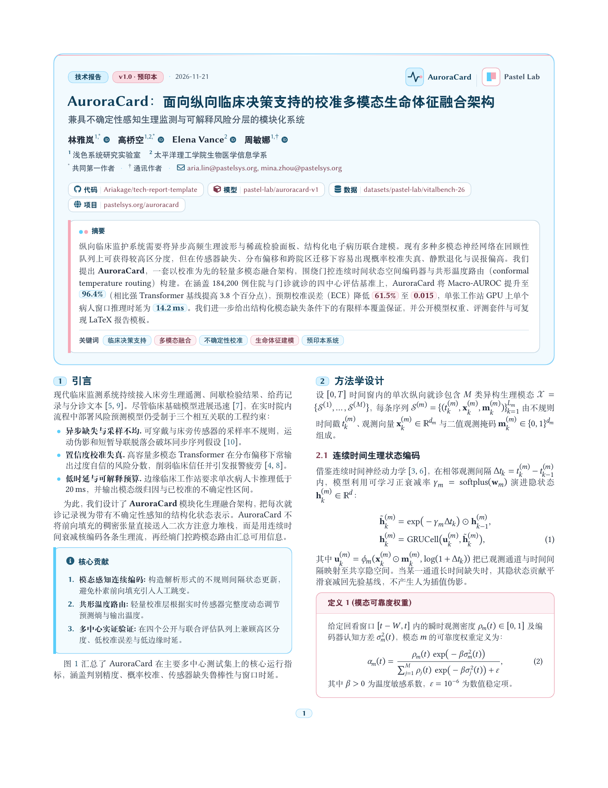
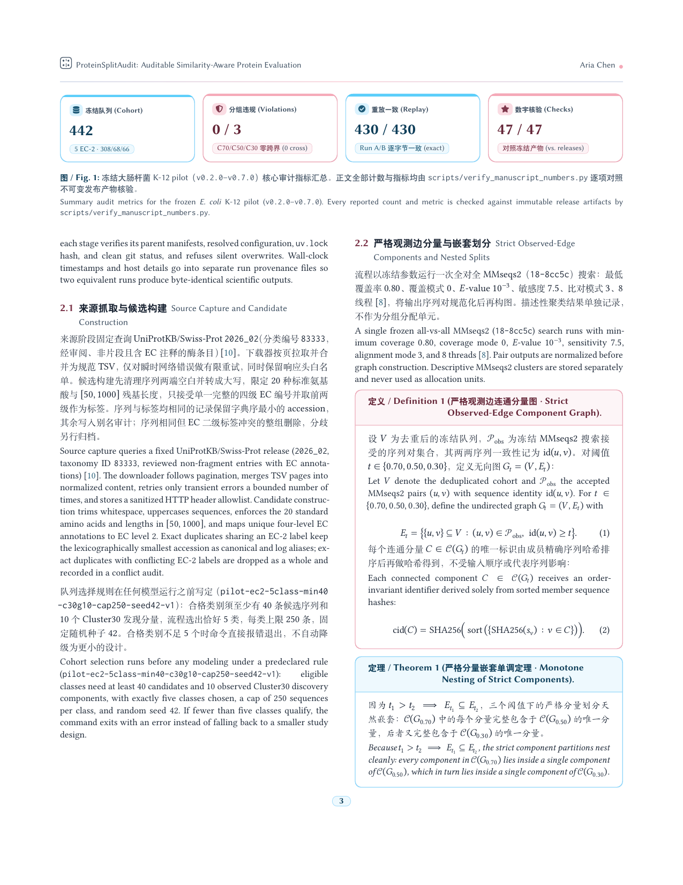
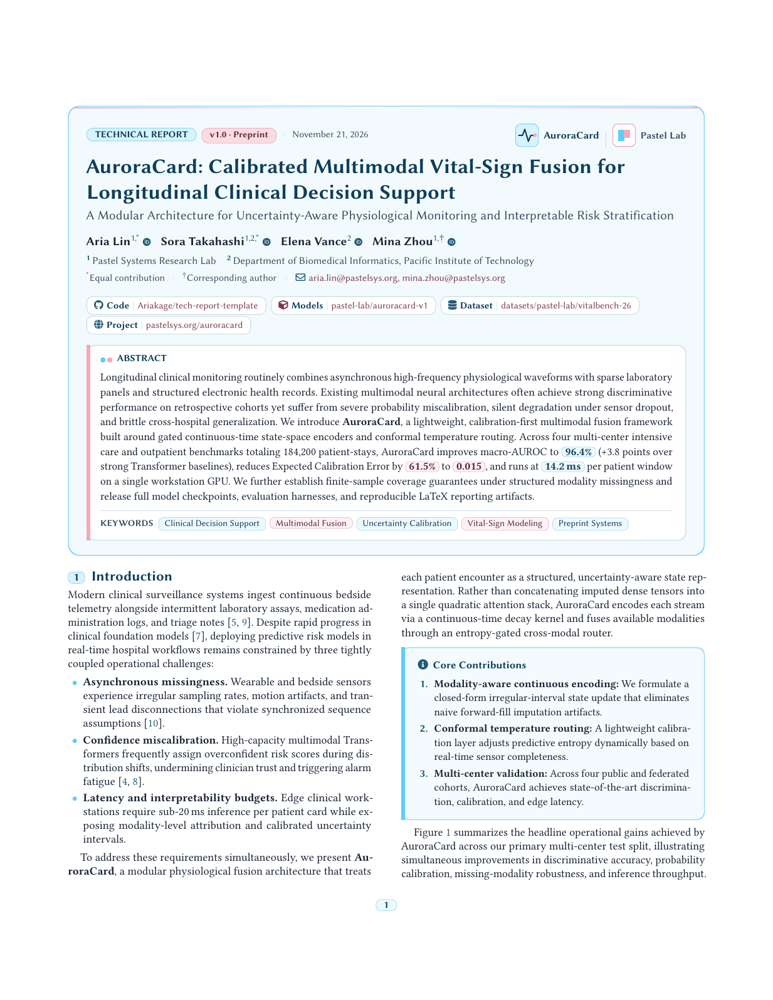
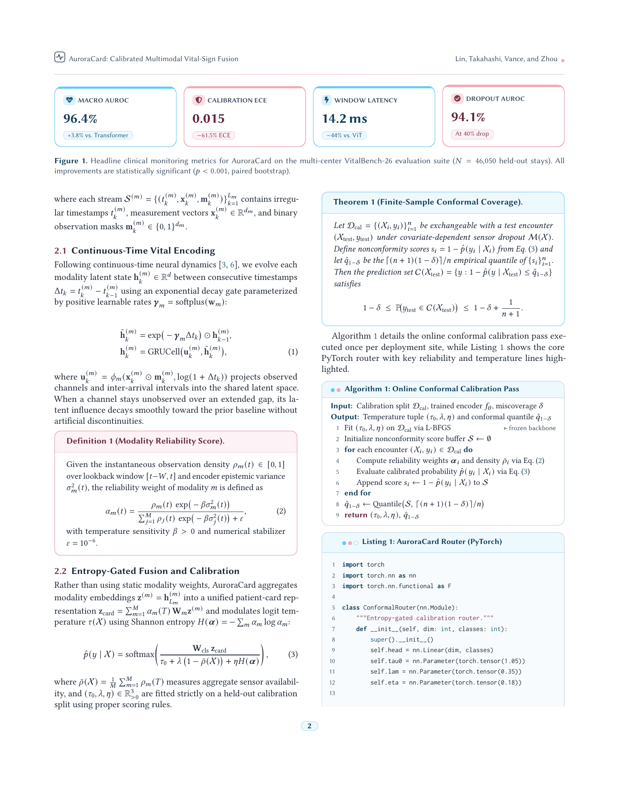
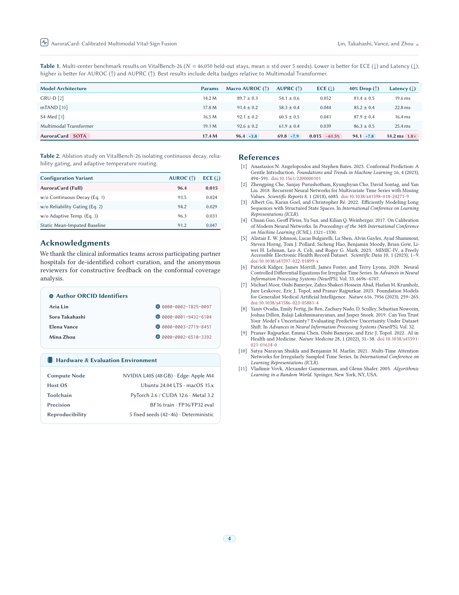
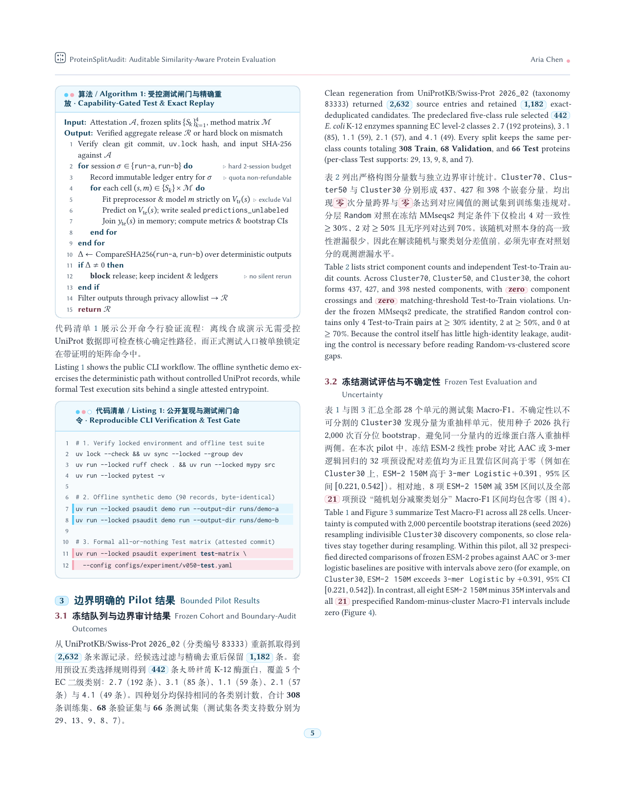
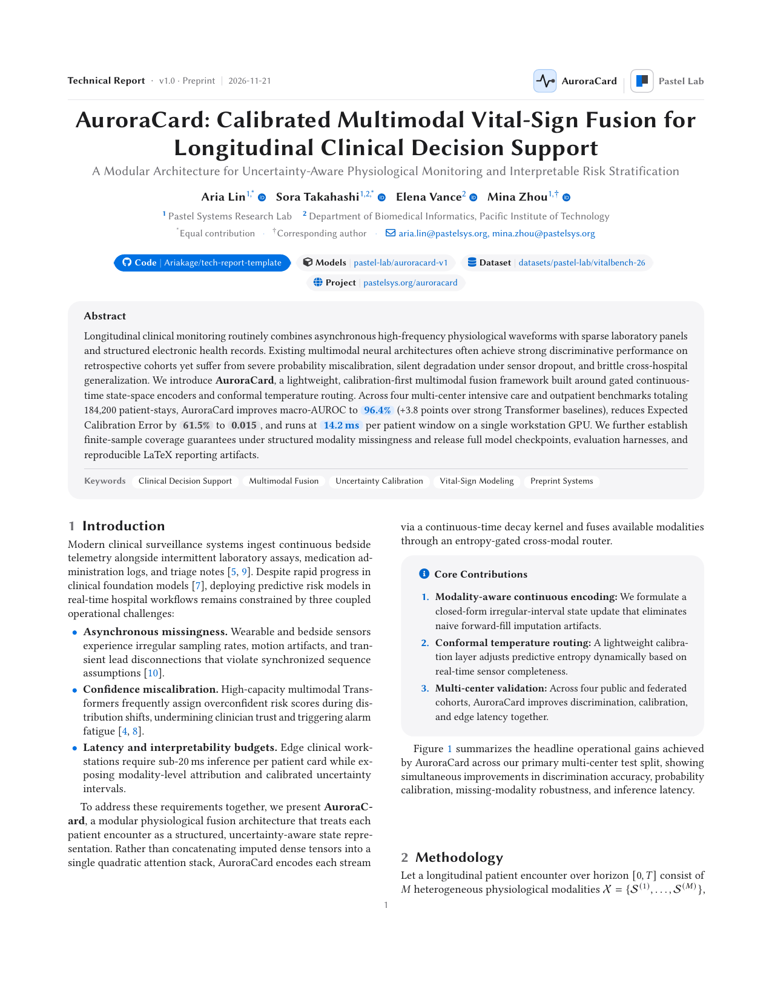

<div align="center">

# AkaTechReport LaTeX Template

**A modern Health-Card / Header-Card academic paper & technical report template built on ACM `acmart` (`sigconf, nonacm`), engineered for `pdfLaTeX` & `XeLaTeX`, pure English / pure Chinese / Bilingual publishing, and one-click theming.**

[](style/healthcard.sty)
[](latexmkrc)
[](#multilingual-modes--中文与双语适配)
[](latexmkrc)

*Default `akatechreport` palette: Sky Cyan `#5BCEFA` · Blossom Pink `#F5A9B8` · Pure White `#FFFFFF` (with B&W print-verified high-contrast shades).*

</div>

---

## Visual Preview / 渲染预览

### Single-Source Multilingual Modes (`theme=akatechreport` · `lang=en|zh|bilingual`)

Compiled from the **exact same `.tex` source** by switching only `lang=en`, `lang=zh`, or `lang=bilingual` — see **[PREVIEW.md](PREVIEW.md)** for full page-by-page spreads of every mode.

<table>
  <tr>
    <td width="33.3%" align="center">
      <br />
      <sub><b>Pure English (`lang=en`)</b><br /><code>pdfLaTeX</code> · 100% Type 1 · arXiv Safe</sub>
    </td>
    <td width="33.3%" align="center">
      <br />
      <sub><b>Pure Chinese (`lang=zh`)</b><br /><code>XeLaTeX</code> (Fandol CJK) · Localized Labels</sub>
    </td>
    <td width="33.3%" align="center">
      <br />
      <sub><b>Bilingual (`lang=bilingual`)</b><br />Paired Headers, Abstracts, Keywords & Prose</sub>
    </td>
  </tr>
  <tr>
    <td width="33.3%" align="center">
      <br />
      <sub>EN · Bento Metrics & Code Card</sub>
    </td>
    <td width="33.3%" align="center">
      <br />
      <sub>ZH · 算法框与代码行高亮</sub>
    </td>
    <td width="33.3%" align="center">
      <br />
      <sub>Bilingual · 双语 Bento 指标与算法代码</sub>
    </td>
  </tr>
</table>

### Pure English Full Preview (`theme=akatechreport, lang=en` · `pdfLaTeX` Type 1)

<table>
  <tr>
    <td width="25%" align="center">
      <br />
      <sub><b>Page 1</b> — Header Card, Dual Logos & ORCID</sub>
    </td>
    <td width="25%" align="center">
      <br />
      <sub><b>Page 2</b> — Bento KPIs, Math & Code Card</sub>
    </td>
    <td width="25%" align="center">
      <br />
      <sub><b>Page 3</b> — Main Table, Note & PGFPlots</sub>
    </td>
    <td width="25%" align="center">
      <br />
      <sub><b>Page 4</b> — ORCID Index, Env Card & Refs</sub>
    </td>
  </tr>
</table>

### Pure Chinese Full Preview (`theme=akatechreport, lang=zh` · `XeLaTeX`)

<table>
  <tr>
    <td width="25%" align="center">
      <br />
      <sub><b>第 1 页</b> — 中文封面卡、摘要与关键词</sub>
    </td>
    <td width="25%" align="center">
      <br />
      <sub><b>第 2 页</b> — Bento 指标、算法与代码高亮</sub>
    </td>
    <td width="25%" align="center">
      <br />
      <sub><b>第 3 页</b> — 跨栏实验表、折线图与提示卡</sub>
    </td>
    <td width="25%" align="center">
      <br />
      <sub><b>第 4 页</b> — ORCID 索引、环境卡与文献</sub>
    </td>
  </tr>
</table>

### Bilingual Full Preview (`theme=akatechreport, lang=bilingual` · `XeLaTeX`)

<table>
  <tr>
    <td width="20%" align="center">
      <br />
      <sub><b>Page 1</b> — 双语标题、摘要与引言</sub>
    </td>
    <td width="20%" align="center">
      <br />
      <sub><b>Page 2</b> — 核心贡献、公式与定理</sub>
    </td>
    <td width="20%" align="center">
      <br />
      <sub><b>Page 3</b> — 双语 Bento、算法与代码</sub>
    </td>
    <td width="20%" align="center">
      <br />
      <sub><b>Page 4</b> — 双语表注、图注与消融</sub>
    </td>
    <td width="20%" align="center">
      <br />
      <sub><b>Page 5</b> — 声明、ORCID 与环境卡</sub>
    </td>
  </tr>
</table>

### One-Click Theme Gallery / 一键换肤实测

Switch the entire template's ribbon, logos, badges, inline highlights, tables, code bars, and plots with **a single package option**:

<table>
  <tr>
    <td width="33.3%" align="center">
      <br />
      <code>theme=claude</code> (<code>anthropic</code>)
    </td>
    <td width="33.3%" align="center">
      <br />
      <code>theme=apple</code> (<code>cupertino</code>)
    </td>
    <td width="33.3%" align="center">
      <br />
      <code>theme=ocean</code>
    </td>
  </tr>
  <tr>
    <td width="33.3%" align="center">
      <br />
      <code>theme=sage</code>
    </td>
    <td width="33.3%" align="center">
      <br />
      <code>theme=lavender</code>
    </td>
    <td width="33.3%" align="center">
      <br />
      <code>theme=mono</code>
    </td>
  </tr>
</table>

#### Featured Theme: `theme=claude` (alias `anthropic` · `anthropic.com` / `claude.ai` Style)

Drops the Health-Card chrome completely and follows `anthropic.com` + `claude.ai` visual tokens (`frontend-design` + `brand-guidelines`): Warm Parchment (`#F5F4ED`), Ivory (`#FAF9F5`), and Oatmeal (`#F0EEE6`) rounded editorial cards (`arc=8–10pt`, subtle `#E2DFD5` cream borders), **serif display headings** (`#141413`), Anthropic Mono uppercase labels (`TECHNICAL REPORT`, `ABSTRACT`, `KEYWORDS`), solid `#141413` Slate Ink contrast anchors (version pill, primary `Code` CTA capsule, Hero KPI #1 tile, and dark Artifact code block with Terracotta `#E88B6E` / Sage `#A7BE89` / Slate `#9AC2EA` syntax), paired with Terracotta (`#D97757`), Slate Blue (`#6A9BCC`), and Sage (`#788C5D`) accents.

<table>
  <tr>
    <td width="25%" align="center">
      <br />
      <sub><b>Claude · Page 1</b> — Parchment Hero, Obsidian CTA Pill & Oatmeal Abstract</sub>
    </td>
    <td width="25%" align="center">
      <br />
      <sub><b>Claude · Page 2</b> — Obsidian Feature KPI #1 & Warm Cream Bento</sub>
    </td>
    <td width="25%" align="center">
      <br />
      <sub><b>Claude · Page 3</b> — `#141413` Artifact Code Block & Sage/Cream Cards</sub>
    </td>
    <td width="25%" align="center">
      <br />
      <sub><b>Claude · Page 4</b> — Parchment Tables, ORCID & Oatmeal Env Card</sub>
    </td>
  </tr>
</table>

#### Featured Theme: `theme=apple` (alias `cupertino` · `apple.com` Style)

Drops the Health-Card chrome in favor of an `apple.com` + `apple-design` Human Interface layout: subtle top local-nav utility hairline above a **centered keynote Hero** (`#1D1D1F` bold Sans headline, `#6E6E73` Pewter subhead, solid `#0071E3` Apple Action Blue primary `Code` capsule CTA), borderless Studio Grey (`#F5F5F7`, `arc=10pt`) Bento & Abstract cards, monochrome Space Titanium (`#424245`) + Link Blue (`#0066CC`) accents, and **`#000000` Stage Black** contrast blocks for code listings (`#2997FF` Sky Blue keywords & macOS dots) and hardware spec cards.

<table>
  <tr>
    <td width="25%" align="center">
      <br />
      <sub><b>Apple · Page 1</b> — Local-Nav Hairline, Centered Hero & Blue CTA</sub>
    </td>
    <td width="25%" align="center">
      <br />
      <sub><b>Apple · Page 2</b> — Borderless Studio Grey Bento & Stage Black Code</sub>
    </td>
    <td width="25%" align="center">
      <br />
      <sub><b>Apple · Page 3</b> — Stage Black Listing & Studio Grey Callouts</sub>
    </td>
    <td width="25%" align="center">
      <br />
      <sub><b>Apple · Page 4</b> — Hairline Tables & Stage Black Hardware Tile</sub>
    </td>
  </tr>
</table>

> Full multi-page renders of every language mode (`lang=en`, `lang=zh`, `lang=bilingual`) and theme live in **[PREVIEW.md](PREVIEW.md)**.

---

## Core Highlights / 核心特性

- **Strict Content / Style Separation（正文与样式彻底隔离）**：[`main.tex`](main.tex) and [`sections/*.tex`](sections/) contain only semantic content and metadata—zero color definitions, layout tweaks, or visual hacks. All styling lives in [`style/healthcard.sty`](style/healthcard.sty).
- **100% Built-in TeX Live & Zero `-shell-escape`（原生宏包 & 零外部依赖）**：Uses exclusively mainstream TeX Live packages (`acmart`, `tcolorbox`, `tikz`, `pgfplots`, `listings`, `algpseudocode`, `microtype`, `orcidlink`, `fontawesome5`, `booktabs`, `tabularx`, `colortbl`, `enumitem`, `needspace`, `hyperref`). Pure English builds (`lang=en`) produce 100% Type 1 arXiv-safe PDFs (30/30 embedded Type 1 fonts via `pdffonts`).
- **Single-Source Multilingual Publishing（纯英文 / 纯中文 / 中英双语单源复用）**：Switch `lang=en`, `lang=zh`, or `lang=bilingual` via a single option. Localized UI labels, XMP/PDF metadata (`\hcsetup`), CJK font selection (TeX Live built-in `FandolSong` / `FandolHei` / `FandolKai`), and bilingual helpers (`\hcsecbi`, `\hcbipair`, `\hcbicaption`, `\hcmetabi`, `\hcdoibi`) work out of the box.
- **Two-Column Micro-Typography & Relative Widths**：Enables `microtype` (`protrusion=true, expansion=true` under pdfLaTeX/LuaLaTeX; `protrusion=true` under XeLaTeX) alongside relative container widths (`\textwidth` / `\linewidth`) to eliminate wide gaps and `Overfull \hbox`.
- **Print-Safe Low-Saturation Palette**：Eliminates default `hyperref` red boxes (`colorlinks=true, pdfborder={0 0 0}`) with low-saturation theme links, and deepens badge ink & code line numbers for crisp grayscale laser printing.
- **Dual Logo Slots + Inner Mini Logo**：Top-right `16pt–20pt` dual slots (`\projectlogo` & `\orglogo`) on Page 1 plus a `10pt` monochrome miniature running-header logo (`\headerlogo`) on Pages 2+.
- **Layered Highlight System & Paper Cards**：Inline metric pills (`\hlblue` / `\hlpink`), pure-`listings` code key-line highlights (`hlblue={...}, hlpink={...}`), table delta badges (`\gain`, `\drop`, `\speedup`), `hcalgorithm`, `hcnote`, `hccaveat`, `hcenvcard`, `hcmetricgrid`, `hctheorem`/`hcdefinition`/`hcproposition`, and `\makeorcidlist`.

---

## Project Structure / 目录结构

```text
tech-report-template/
├── main.tex                    # Single-source entry point (metadata, logo slots & \input)
├── latexmkrc                   # Pure pdfLaTeX / XeLaTeX config (outputs isolated in build/)
├── Makefile                    # make / make xelatex / make preview / make clean
├── README.md
├── PREVIEW.md                  # Full multi-page EN / ZH / Bilingual & theme gallery
├── style/
│   └── healthcard.sty          # Style package, akatechreport theme engine & CJK support
├── sections/
│   ├── 00_abstract.tex         # English abstract (with inline metric highlights)
│   ├── 00_abstract_zh.tex      # Chinese abstract (active in lang=zh & lang=bilingual)
│   ├── 01_introduction.tex     # Single-source bilingual Introduction + Bento metric cards
│   ├── 02_methodology.tex      # Equations, Definition/Theorem, Algorithm & Code cards
│   ├── 03_experiments.tex      # Delta-badge Table, Note card, PGFPlots & Ablation
│   └── 04_conclusion.tex       # Caveat card, Auto ORCID directory & Hardware Spec card
├── figures/
│   ├── logos.tex               # Pure-TikZ vector demo logos (swap with PDF/PNG easily)
│   └── fig_dropout.tex         # Standalone native PGFPlots vector figure
├── bib/
│   └── references.bib          # BibTeX references
├── assets/                     # Rendered EN / ZH / Bilingual / Theme preview PNGs
└── build/                      # Build output directory (gitignored: main.pdf, aux, log...)
```

---

## Quick Start / 快速开始

### Pure English (`lang=en`, default, zero `-shell-escape`)

```bash
make
# or directly:
latexmk -pdf main.tex
```

### Pure Chinese (`lang=zh`) or Bilingual (`lang=bilingual`)

```bash
make xelatex
# or directly:
latexmk -xelatex main.tex
```

The compiled PDF and all auxiliary files (`.aux`, `.bbl`, `.log`, `.listing`, `.synctex.gz`) are cleanly isolated in `build/main.pdf`, keeping the project root spotless.

Generate PNG previews (`build/preview/page-*.png`, requires `pdftoppm`) or clean outputs:

```bash
make preview
make clean
```

### Overleaf & arXiv

- **Overleaf**: Upload the repo (or import from GitHub), set compiler to **pdfLaTeX** (`lang=en`) or **XeLaTeX** (`lang=zh` / `lang=bilingual`), and set main document to `main.tex`. No extra flags required.
- **arXiv**: For `lang=en`, run `make` locally once and include `main.tex`, `style/`, `sections/`, `figures/`, `bib/`, and `build/main.bbl` (renamed alongside `main.tex` as `main.bbl`).

---

## One-Click Theming / 一键换肤

Select the canonical `akatechreport` theme or any built-in variant via package option in `main.tex`:

```latex
\documentclass[sigconf, nonacm]{acmart}
\usepackage[theme=akatechreport, lang=en]{style/healthcard}
```

| Option | Values | Default | Description |
| :--- | :--- | :--- | :--- |
| `theme` | `akatechreport` \| `claude` \| `apple` \| `ocean` \| `sage` \| `lavender` \| `mono` | `akatechreport` | Seven curated themes (`pastel` default alias; `anthropic` alias for `claude`; `cupertino` alias for `apple`) |
| `lang` | `en` \| `zh` \| `bilingual` | `en` | Pure English (`pdfLaTeX` Type 1), Pure Chinese, or Chinese+English Bilingual |
| `biorder` | `zh-en` \| `en-zh` | `zh-en` | Primary language order in `lang=bilingual` mode |
| `cjkfont` | `fandol` \| `mac` \| `windows` \| `ubuntu` \| `none` | `fandol` | Built-in TeX Live Fandol OpenType CJK fonts (portable) or OS presets |
| `orcid` | `brand` \| `official` | `brand` | Theme-harmonized ORCID icon or official ORCID green `#A6CE39` |
| `ribbon` | `gradient` \| `stripe` \| `none` | `gradient` | Header-card top accent ribbon style |
| `accent` | `blue` \| `pink` | `blue` | Swap primary and accent roles (`accent=pink`) |
| `headerstyle` | `layered` \| `clean` | `layered` | Tinted outer card + pure-white Abstract (`layered`) or inverse (`clean`) |

### Custom Two-Hex Skinning

Override with any two brand hex colors directly in `main.tex` without touching `healthcard.sty`:

```latex
\hcsettheme{primary=5BCEFA, accent=F5A9B8}
```

> Single-column support: Change `\documentclass[sigconf, nonacm]{acmart}` to `\documentclass[manuscript, nonacm]{acmart}` or `\documentclass[11pt]{article}`—all cards and widths automatically adapt.

---

## Multilingual Modes & Rich Metadata / 中文与双语适配

Switch seamlessly between **Pure English (`lang=en`)**, **Pure Chinese (`lang=zh`)**, and **Bilingual (`lang=bilingual`)** with one package option:

```latex
% Pure English (default — 100% pdfLaTeX + Type 1 arXiv safe)
\usepackage[theme=akatechreport, lang=en]{style/healthcard}

% Pure Chinese (recommended: make xelatex; pdfLaTeX CJKutf8 fallback also supported)
\usepackage[theme=akatechreport, lang=zh]{style/healthcard}

% Chinese + English Bilingual (supports single-source switching to en or zh!)
\usepackage[theme=akatechreport, lang=bilingual, biorder=zh-en]{style/healthcard}
```

### Unified Metadata & PDF Properties (`\hcsetup`)

`\hcsetup{...}` acts as a single metadata hub — automatically keeping both classic PDF `/Info` (`Title` / `Author` / `Subject` / `Keywords` / `Creator`, via `keeppdfinfo=true`) and rich XMP streams (`dc:publisher`, `dc:language`, `prism:subtitle`, `prism:doi`, `prism:url`, `xmpRights:WebStatement`, `Iptc4xmpCore:CiEmailWork`) in sync across `pdfLaTeX`, `XeLaTeX`, `CJKutf8`, and `fallback` (`article`) builds, while stripping `acmart`'s default ACM publisher tag on independent reports:

```latex
\hcsetup{
  %% Optional: can also set main EN title/subtitle directly here instead of \title / \subtitle
  % title={English Title},
  % subtitle={English Subtitle},
  reportlabel={\hcbisep{技术报告}{Technical Report}},
  reportbadge={v1.0 \textperiodcentered\ \hcbi{预印本}{Preprint}},
  reportdate={2026-11-21},
  titlezh={中文主标题},
  subtitlezh={中文副标题},
  keywordszh={中文关键词1, 中文关键词2},
  keywords={Keyword 1, Keyword 2},
  venue={AkaTechReport Showcase},
  publisher={Pastel Systems Research Lab},  % defaults to venue if omitted
  version={v1.0},
  doi={10.5281/zenodo.22164608},
  arxiv={q-bio.QM},
  url={https://example.org/project},
  license={Apache-2.0 / CC-BY-4.0},
  licenseurl={https://creativecommons.org/licenses/by/4.0/},
  % pdflang={zh-CN},        % auto-derived from lang/biorder if omitted
  % pubtype={article},      % defaults to article (overrides acmart's book default)
  % contactemail={...},     % auto-captured from first \hcemail in \hccorrespondence
  % subject={Custom PDF Subject}
}
```

### Single-Source Bilingual Helpers

- `\begin{abstractzh}...\end{abstractzh}` + `\begin{abstract}...\end{abstract}` — paired dual-language Abstract card
- `\hcsecbi{中文标题}{English Title}` / `\hcsubsecbi{中文小节}{English Subsection}` / `\hcparbi{中文段首}{English}` — bookmark-safe bilingual headings
- `\hcbipair{中文正文段落}{English companion paragraph}` — paired bilingual blocks (collapses to single language in `lang=en` or `lang=zh`)
- `\hcbicaption{中文图注}{English caption}` — bilingual figure/table captions
- `\hcbi{中文}{English}` / `\hcbisep{中文}{English}` / `\hcmetabi{中文}{English}{Val}` / `\hcdoibi[中文]{EN}{DOI}` — inline terms, card titles, resource pills, and clickable DOIs

---

## Semantic API Cheat Sheet / 常用语义接口

### 1. Logo Slots（首页双标 + 内页微缩标）

```latex
% Drop PDF/PNG files into figures/ and load in one line:
\projectlogoimage[18pt]{aminfer_logo.pdf}
\orglogoimage[18pt]{srinternet_logo.pdf}
\headerlogoimage[10pt]{aminfer_mini.pdf}

% Or pass pure-TikZ vector macros (zero external files):
\projectlogo{\demoprojectlogo}
\orglogo{\demoorglogo}
\headerlogo{\demoheaderlogo}
% \noheaderlogo  % Optional: revert running-header mark to a minimal dot
```

### 2. Authors, ORCID & Metadata Pills

```latex
\hcauthor[1,*]{\hcbi{林雅岚}{Aria Lin}}{0000-0002-1825-0097} % Leave 3rd arg {} if no ORCID
\hcaffiliation[1]{\hcbisep{浅色系统研究实验室}{Pastel Systems Research Lab}}
\hcauthornote{\textsuperscript{*}\hcbisep{共同第一作者}{Equal contribution}}
\hccorrespondence{\hcemail{aria.lin@pastelsys.org}}

% Icons auto-matched for EN/ZH labels (Code/代码, Models/模型, Dataset/数据, Project/项目, Archive/归档, etc.)
\hcmetabi{代码}{Code}{\hcghlink{Ariakage/tech-report-template}}
\hcdoibi[归档]{Archive}{10.5281/zenodo.22164608}
\makeorcidlist
```

### 3. Layered Highlights（行内 + 代码行 + 表格增幅）

- **Inline micro-highlights**: `\hlblue{96.4\%}` (alias `\hlprimary{...}`), `\hlpink{14.2\,ms}` (alias `\hlaccent{...}`)
- **Table delta & status badges**: `\gain{+3.8}`, `\drop{-61.5\%}`, `\speedup{1.8\times}`, `\hcbadge{Verified}`, `\hcpinkbadge{SOTA}`
- **Code block key-line highlighting** (pure `listings`, zero `-shell-escape`):

```latex
\begin{hccode}[Fused Dequantization (Metal)]{language=C++, hlblue={12,13}, hlpink={18,19}}{label=lst:metal}
// Highlighted lines receive a soft pastel wash and crisp left accent tick
\end{hccode}
```

### 4. Built-in Academic Components

| Environment / Command | Purpose |
| :--- | :--- |
| `\begin{hcalgorithm}[Title]{label=alg:id}` | Rounded pseudocode card (`algpseudocode`) matching code cards |
| `\begin{hccard}[Title]` / `\begin{hcpinkcard}[Title]` | Primary takeaway card / Accent key-finding card |
| `\begin{hcnote}[Title]` / `\begin{hccaveat}[Title]` | Neutral slate engineering note / Warm amber limitation & caveat card |
| `hctheorem` / `hcdefinition` / `hcproposition` | Numbered formal math cards with cross-reference labels |
| `hcmetricgrid` + `\hcmetriccard{blue\|pink}{icon}{Label}{Val}{Delta}` | Full-width or column-width Bento KPI cards (`tabularx`) |
| `hctable` + `\hctoprule` / `\hctablehead` / `\hcaltrow` / `\hcbestrow` | Gap-free colored `booktabs` + `colortbl` tables |
| `hcenvcard` + `\hcenvrow{Key}{Value}` | Hardware / testbed spec card (pairs cleanly beside References) |
| `hcframecard` + `pgfplots` `hcaxis` / `hcbaraxis` | Theme-synchronized native vector plots |
