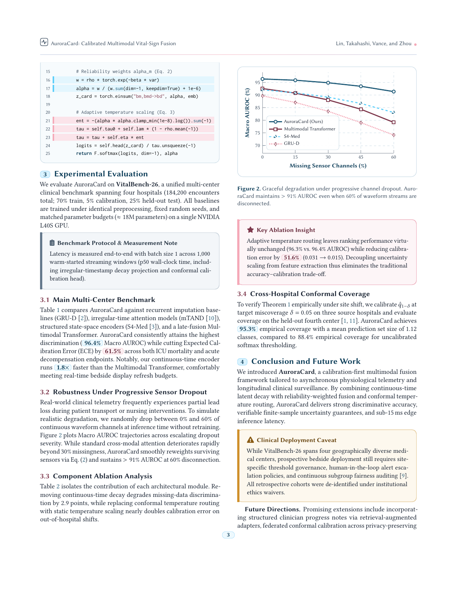
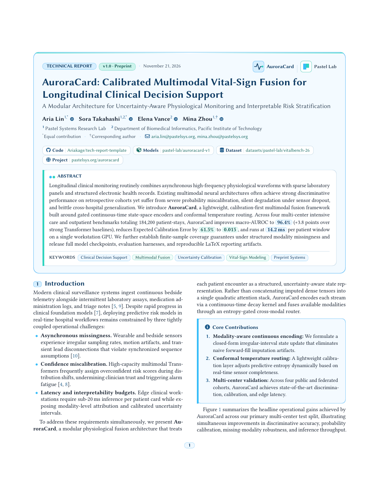
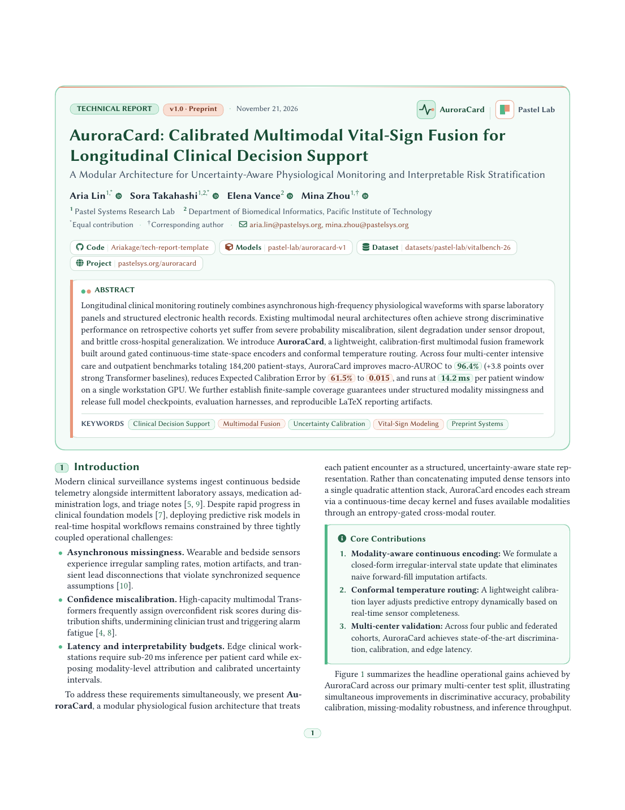
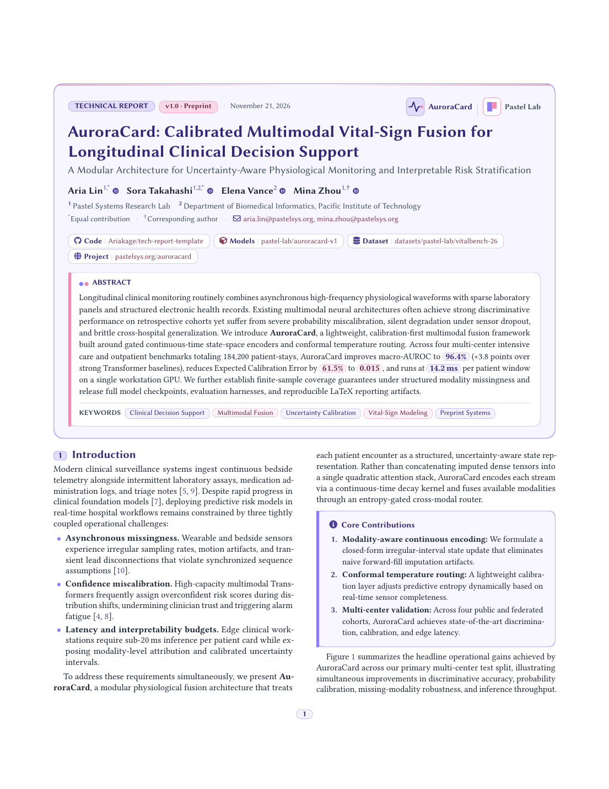
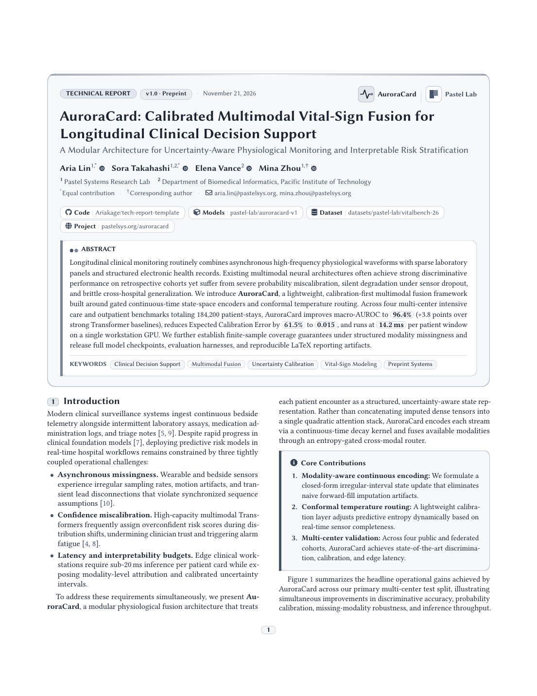

<div align="center">

# Health-Card LaTeX Paper & Technical Report Template

**A modern pastel Health-Card / Header-Card academic paper & technical report template built on ACM `acmart` (`sigconf, nonacm`), engineered for pure `pdfLaTeX`, arXiv safety, and one-click theming.**

[](style/healthcard.sty)
[](latexmkrc)
[-5BCEFA?style=flat-square)](style/healthcard.sty)
[](#one-click-theming--一键换肤)

*Default signature palette: Sky Cyan `#5BCEFA` · Blossom Pink `#F5A9B8` · Pure White `#FFFFFF` (with B&W print-verified high-contrast shades).*

</div>

---

## Visual Preview / 渲染预览

### Full 4-Page Showcase (`theme=pastel`, default)

<table>
  <tr>
    <td width="50%" align="center">
      <br />
      <sub><b>Page 1</b> — Dual 18pt Logo Slots, Gradient Ribbon, Clickable Vector ORCID, Resource Pills, Inline Highlights & Two-Column Body</sub>
    </td>
    <td width="50%" align="center">
      <br />
      <sub><b>Page 2</b> — 10pt Mini Running-Header Logo, Bento Vital-Metric Cards, Definition/Theorem Cards & Matched Algorithm Card</sub>
    </td>
  </tr>
  <tr>
    <td width="50%" align="center">
      <br />
      <sub><b>Page 3</b> — Pure-<code>listings</code> Key-Line Highlighting, Neutral Note & Warm Amber Caveat Cards, Native PGFPlots Figure</sub>
    </td>
    <td width="50%" align="center">
      <br />
      <sub><b>Page 4</b> — Delta-Badge Benchmark Table, Ablation Table, Auto ORCID Directory, Hardware Spec Card & Balanced References</sub>
    </td>
  </tr>
</table>

### One-Click Theme Gallery / 一键换肤实测

Switch the entire template's ribbon, logos, badges, inline highlights, tables, code bars, and plots with **a single package option**:

<table>
  <tr>
    <td width="25%" align="center">
      <br />
      <code>theme=ocean</code>
    </td>
    <td width="25%" align="center">
      <br />
      <code>theme=sage</code>
    </td>
    <td width="25%" align="center">
      <br />
      <code>theme=lavender</code>
    </td>
    <td width="25%" align="center">
      <br />
      <code>theme=mono</code>
    </td>
  </tr>
</table>

---

## Core Highlights / 核心特性

- **Strict Content / Style Separation（正文与样式彻底隔离）**：[`main.tex`](main.tex) and [`sections/*.tex`](sections/) contain only semantic content and metadata—zero color definitions, layout tweaks, or visual hacks. All styling lives in [`style/healthcard.sty`](style/healthcard.sty).
- **100% `pdfLaTeX` & arXiv Safe（原生宏包 & 零 `-shell-escape`）**：Uses exclusively mainstream TeX Live built-in packages (`acmart`, `tcolorbox`, `tikz`, `pgfplots`, `listings`, `algpseudocode`, `microtype`, `orcidlink`, `fontawesome5`, `booktabs`, `tabularx`, `colortbl`, `enumitem`, `hyperref`). **No `minted`, no `-shell-escape`, no local `.otf`/`.ttf` fonts**—all 30 embedded font subsets verified as Type 1 via `pdffonts`.
- **Two-Column Micro-Typography & Relative Widths**：Enables `microtype` (`protrusion=true, expansion=true`) to eliminate wide gaps and `Overfull \hbox` in narrow two-column prose. All cards, tables, metric grids, code boxes, and plots strictly use relative widths (`\textwidth` / `\linewidth`).
- **Print-Safe Low-Saturation Palette**：Eliminates ugly default `hyperref` red boxes (`colorlinks=true, pdfborder={0 0 0}`) with low-saturation theme links, and deepens badge text & code line numbers for crisp grayscale laser printing.
- **Dual Logo Slots + Inner Mini Logo**：Top-right `16pt–20pt` dual slots (`\projectlogo` & `\orglogo`) on Page 1 plus a `10pt` monochrome miniature running-header logo (`\headerlogo`) on Pages 2+.
- **Layered Highlight System**：Low-saturation inline metric pills (`\hlblue` / `\hlpink`), pure-`listings` code key-line highlights (`hlblue={...}, hlpink={...}`), and compact table delta badges (`\gain`, `\drop`, `\speedup`).
- **Complete System / AI Paper Components**：Matched rounded pseudocode card (`hcalgorithm`), neutral slate note card (`hcnote`), warm amber caveat card (`hccaveat`), hardware/testbed spec card (`hcenvcard`), Bento metric grid (`hcmetricgrid`), formal Theorem/Definition/Proposition cards, and auto-generated ORCID directory (`\makeorcidlist`).

---

## Project Structure / 目录结构

```text
tech-report-template/
├── main.tex                    # Clean entry point (metadata, logo slots & \input)
├── latexmkrc                   # Pure pdfLaTeX config (isolates all outputs to build/)
├── Makefile                    # make / make preview / make clean
├── README.md
├── style/
│   └── healthcard.sty          # Self-contained style package & semantic theme engine
├── sections/
│   ├── 00_abstract.tex         # Abstract (with inline highlight examples)
│   ├── 01_introduction.tex     # Introduction + full-width Bento metric cards
│   ├── 02_methodology.tex      # Equations, Definition/Theorem, Algorithm & Code cards
│   ├── 03_experiments.tex      # Delta-badge Table, Note card, Ablation & PGFPlots
│   └── 04_conclusion.tex       # Caveat card, Auto ORCID directory & Hardware Spec card
├── figures/
│   ├── logos.tex               # Pure-TikZ vector demo logos (swap with PDF/PNG easily)
│   └── fig_dropout.tex         # Standalone native PGFPlots vector figure
├── bib/
│   └── references.bib          # BibTeX references
├── assets/                     # Rendered README preview screenshots
└── build/                      # Build output directory (gitignored: main.pdf, aux, log...)
```

---

## Quick Start / 快速开始

### Local Build (`latexmk` / `make`, zero `-shell-escape`)

```bash
make
# or directly:
latexmk -pdf main.tex
```

The compiled PDF and all auxiliary files (`.aux`, `.bbl`, `.log`, `.listing`, `.synctex.gz`) are cleanly isolated in `build/main.pdf`, keeping the project root spotless.

Generate PNG previews (`build/preview/page-*.png`, requires `pdftoppm`):

```bash
make preview
```

Clean build outputs:

```bash
make clean
```

### Overleaf & arXiv

- **Overleaf**: Upload the repo (or import from GitHub), set compiler to **pdfLaTeX**, and set main document to `main.tex`. No extra flags required.
- **arXiv**: Run `make` locally once, include `main.tex`, `style/`, `sections/`, `figures/`, `bib/`, and `build/main.bbl` (renamed alongside `main.tex` as `main.bbl` per arXiv guidelines).

---

## One-Click Theming / 一键换肤

Select a built-in theme via package option in `main.tex`:

```latex
\documentclass[sigconf, nonacm]{acmart}
\usepackage[theme=pastel]{style/healthcard}
```

| Option | Values | Default | Description |
| :--- | :--- | :--- | :--- |
| `theme` | `pastel` \| `ocean` \| `sage` \| `lavender` \| `mono` | `pastel` | Five curated, B&W-print-verified color themes |
| `orcid` | `brand` \| `official` | `brand` | Theme-harmonized ORCID icon or official ORCID green `#A6CE39` |
| `ribbon` | `gradient` \| `stripe` \| `none` | `gradient` | Header-card top accent ribbon style |
| `accent` | `blue` \| `pink` | `blue` | Swap primary and accent roles (`accent=pink`) |
| `headerstyle` | `layered` \| `clean` | `layered` | Tinted outer card + pure-white Abstract (`layered`) or inverse (`clean`) |

### Custom Two-Hex Skinning

Override with any two brand hex colors directly in `main.tex` without touching `healthcard.sty`:

```latex
\hcsettheme{primary=5BCEFA, accent=F5A9B8}
```

> Single-column support: Change `\documentclass[sigconf, nonacm]{acmart}` to `\documentclass[manuscript, nonacm]{acmart}` or `\documentclass[11pt]{article}`—all cards and widths automatically adapt.

---

## Semantic API Cheat Sheet / 常用语义接口

### 1. Logo Slots（首页双标 + 内页微缩标）

```latex
% Drop PDF/PNG files into figures/ and load in one line:
\projectlogoimage[18pt]{aminfer_logo.pdf}
\orglogoimage[18pt]{srinternet_logo.pdf}
\headerlogoimage[10pt]{aminfer_mini.pdf}

% Or pass pure-TikZ vector macros (zero external files):
\projectlogo{\demoprojectlogo}
\orglogo{\demoorglogo}
\headerlogo{\demoheaderlogo}
% \noheaderlogo  % Optional: revert running-header mark to a minimal dot
```

### 2. Authors, ORCID & Metadata Pills

```latex
\hcauthor[1,*]{Aria Lin}{0000-0002-1825-0097} % Leave 3rd arg {} if no ORCID
\hcaffiliation[1]{Pastel Systems Research Lab}
\hcauthornote{\textsuperscript{*}Equal contribution}
\hccorrespondence{\hcemail{aria.lin@pastelsys.org}}

% Icons auto-matched for Code/GitHub/Models/Dataset/Project/Demo/Leaderboard/Blog/Paper
\hcmetadata[Code]{\hcghlink{Ariakage/tech-report-template}}
\hcmetadata[Models]{\hchflink{pastel-lab/auroracard-v1}}
\hckeywords{Clinical AI, Multimodal Fusion, Uncertainty Calibration}

% Inline ORCID & auto-populated ORCID directory card
\hcorcid{0000-0002-1825-0097}
\hcorcidfull{0000-0002-1825-0097}
\makeorcidlist
```

### 3. Layered Highlights（行内 + 代码行 + 表格增幅）

- **Inline micro-highlights**: `\hlblue{96.4\%}` (alias `\hlprimary{...}`), `\hlpink{14.2\,ms}` (alias `\hlaccent{...}`)
- **Table delta & status badges**: `\gain{+3.8}`, `\drop{-61.5\%}`, `\speedup{1.8\times}`, `\hcbadge{Verified}`, `\hcpinkbadge{SOTA}`
- **Code block key-line highlighting** (pure `listings`, zero `-shell-escape`):

```latex
\begin{hccode}[Fused Dequantization (Metal)]{language=C++, hlblue={12,13}, hlpink={18,19}}{label=lst:metal}
// Highlighted lines receive a soft pastel wash and crisp left accent tick
\end{hccode}
```

### 4. Built-in Academic Components

| Environment / Command | Purpose |
| :--- | :--- |
| `\begin{hcalgorithm}[Title]{label=alg:id}` | Rounded pseudocode card (`algpseudocode`) matching code cards |
| `\begin{hccard}[Title]` / `\begin{hcpinkcard}[Title]` | Primary takeaway card / Accent key-finding card |
| `\begin{hcnote}[Title]` / `\begin{hccaveat}[Title]` | Neutral slate engineering note / Warm amber limitation & caveat card |
| `hctheorem` / `hcdefinition` / `hcproposition` | Numbered formal math cards with cross-reference labels |
| `hcmetricgrid` + `\hcmetriccard{blue\|pink}{icon}{Label}{Val}{Delta}` | Full-width or column-width Bento KPI cards (`tabularx`) |
| `hctable` + `\hctoprule` / `\hctablehead` / `\hcaltrow` / `\hcbestrow` | Gap-free colored `booktabs` + `colortbl` tables |
| `hcenvcard` + `\hcenvrow{Key}{Value}` | Hardware / testbed spec card (pairs cleanly with `\hcbalance` beside References) |
| `hcframecard` + `pgfplots` `hcaxis` / `hcbaraxis` | Theme-synchronized native vector plots |
